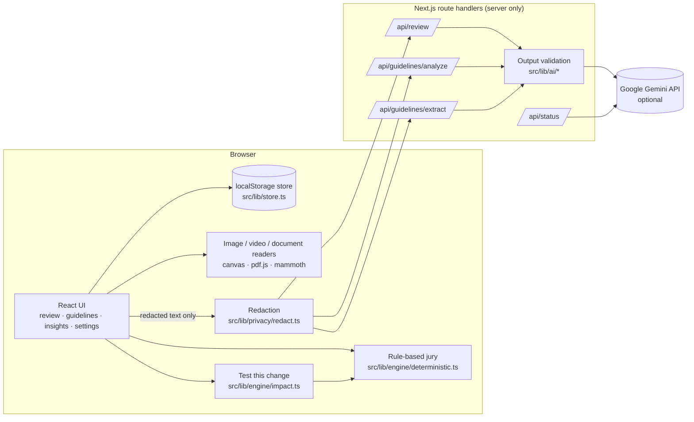

# Architecture

Plumbline Jury is a Next.js (App Router) application. Almost everything runs in the browser; the server only proxies optional AI requests so the API key is never exposed.

## Main flows

1. **Review.** The draft (text, plus optional image, video, captions or an imported document) runs through the rule-based jury in the browser. If live AI is enabled and the item isn't confidential, redacted text goes to `/api/review`. The server validates every AI finding against the submitted text and the brand's rules and facts, then returns it. The coordinator (`engine/coordinator.ts`) merges duplicates and keeps disagreements. Placeholders are restored in the browser.
2. **Decide.** Creators accept, edit, dismiss (with a reason) or escalate findings, and discuss them in comment threads with @mentions. Accepting a fix creates a new version. A manager or reviewer then approves or requests changes, following the permission matrix in `src/lib/roles.ts`.
3. **Learn.** Dismissal reasons feed Insights (`lib/insights.ts`) and Guideline Intelligence (`engine/conflicts.ts`, optional AI analysis).
4. **Change guidelines safely.** A proposed rule, term or clarification can be tested with **Test this change**: every version of every reviewed item is replayed under the current and proposed rules, and the difference is scored against recorded human decisions. A reviewer then approves or rejects it; previous wording is versioned.

## Key technical decisions

| Decision | Why |
|---|---|
| Rule-based checks first, AI optional | Works with no key, is reproducible, can be tested, and costs nothing. The AI adds judgement but never replaces evidence. |
| Evidence re-validated server-side | Models invent IDs and quotes. Every evidence reference is resolved against the loaded rules and facts, excerpts are replaced with the source text, unknown IDs are marked **Unverified**, and quotes not found in the content are dropped. |
| One structured AI call per review | All four jurors share one JSON-schema request to save free-tier quota while keeping findings identifiable by juror. |
| Content treated as untrusted | Prompts wrap content in delimiters and tell the model to ignore instructions inside it. Validation is the real guard. |
| Redaction in the browser | Sensitive values never reach the server or the model. Placeholders are restored only in the browser. |
| Media analysed in the browser | Images, video frames, captions and documents never leave the device, which avoids upload costs and confidentiality risks. |
| Rule roles per brand | Checks cite each brand's own rule for that type of issue, so multi-brand evidence is correct. |
| localStorage persistence | No database, no accounts, zero cost, so judges can use it instantly. It's documented as prototype storage, not an audit system. |
| Simulated roles with an enforced matrix | Judges can walk the whole workflow without logins; permissions are still checked in the store, not only hidden in the UI. |

## APIs, models, libraries and services

| Item | Use | Cost |
|---|---|---|
| Google Gemini API (`GEMINI_MODEL`, default `gemini-2.5-flash`) | Optional AI jurors, conflict analysis, rule extraction | Free tier; optional |
| Next.js 16, React 19, TypeScript | App framework | Free |
| Tailwind CSS 4, lucide-react, Recharts | UI, icons, charts | Free |
| pdfjs-dist | PDF text extraction in the browser | Free |
| mammoth | Word (.docx) text extraction in the browser | Free |
| Vitest | Unit tests | Free |
| ffmpeg (dev only) | Generates the demo video in `scripts/make-demo-assets.mjs` | Free |
| Vercel | Hosting | Free tier |

No datasets were used. All demo data (Northstar Nutrition, Aurora Coffee, facts, review history, images, PDF, video and captions) is fictional and generated for this project.

## Source map

| Path | Responsibility |
|---|---|
| `src/lib/types.ts` | Shared contracts |
| `src/lib/engine/*` | Rule-based checks, evidence, conflicts, coordinator, diff, contrast and colour, impact replay |
| `src/lib/ai/*` | Gemini client, prompts and output validation (server only) |
| `src/lib/privacy/redact.ts` | Redaction and restoration |
| `src/lib/image`, `src/lib/video`, `src/lib/import` | Media and document readers |
| `src/lib/store.ts` | State, persistence, migrations and permission-checked actions |
| `src/lib/roles.ts` | Roles and permission matrix |
| `src/components/*` | UI, including the guided tour |
| `tests/*` | Vitest unit tests |
